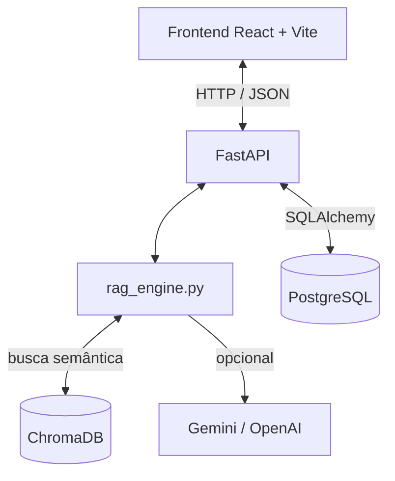

# Moda Inteligente: RAG para o varejo de moda masculina

Projeto de Portfólio (Engenharia de Software, Católica SC), linha de Inteligência Artificial.
Autora: Anna Koerich.

## Objetivo

Ajudar pequenos lojistas de moda masculina a decidir o que comprar. O lojista faz uma pergunta
("vale a pena comprar calça skinny?"), o sistema busca as tendências mais parecidas numa base
vetorial, cruza com o estoque da loja e devolve uma recomendação com a justificativa e as fontes
usadas.

## Arquitetura



- **Frontend:** React 19, Vite, lucide-react.
- **Backend:** FastAPI, Python 3.11.
- **Banco relacional:** PostgreSQL 16 (`produtos`, `tendencias`, `recomendacoes`).
- **Banco vetorial:** ChromaDB persistente, coleção `tendencias_moda`.
- **LLM:** Gemini (ou OpenAI) via LangChain. Sem chave configurada, ou se a API falhar, a
  resposta é montada por regras locais em `sintetizar_resposta_contextual`.

Documentação completa (C4, DER, decisões) em [docs/WIKI_ARQUITETURA.md](docs/WIKI_ARQUITETURA.md).

## Estrutura

```
.github/workflows/     ci.yml (lint, testes, Sonar, imagens, deploy) e rollback.yml
data/                  base de tendências e coletas do Google Trends (ver data/README.md)
pipeline/              coleta e pré-processamento dos dados do Google Trends
deploy/                script executado na VM e modelos de .env
docs/                  arquitetura, ADRs, LGPD
frontend/              aplicação React (servida por Nginx em produção)
infra/caddy/           proxy reverso com HTTPS
infra/monitoramento/   Prometheus, Grafana e alertas (ver docs/observabilidade.md)
tests/                 testes da API, do RAG e da busca vetorial
main.py                rotas da API
rag_engine.py          recuperação + síntese da recomendação
vector_db.py           consulta ao ChromaDB
ingestion.py           indexa data/market_trends.json no ChromaDB e no PostgreSQL
models.py / schemas.py modelos SQLAlchemy e schemas Pydantic
docker-compose.yml     ambiente local
docker-compose.prod.yml  produção e homologação (imagens do GHCR)
```

## Rodando localmente

Pré-requisitos: Python 3.11+, Node 20+, PostgreSQL (local ou via Docker).

```bash
cp .env.example .env            # ajustar DATABASE_URL e a chave do Gemini

python -m venv venv
venv\Scripts\pip install -r requirements.txt
venv\Scripts\python ingestion.py           # aplica as migrations e indexa a base de tendências
venv\Scripts\uvicorn main:app --reload --port 8000

cd frontend
npm install
npm run dev                                 # http://localhost:5173
```

Ou tudo com Docker: `docker compose up --build` (frontend em http://localhost:8080, API em
http://localhost:8000/docs). Na primeira vez, rodar `docker compose exec backend python ingestion.py`.

## Login e usuários

Toda a aplicação exige login: sem ele só aparece a tela de entrada. A API responde 401 em todas as
rotas de dados; ficam abertas apenas `/`, `/health` (healthcheck) e `/auth/login`. O token JWT vale
por 8 horas e fica na `sessionStorage` (some ao fechar a aba).

Há dois perfis:

| Perfil | Pode |
|---|---|
| `usuario` | usar o painel, o consultor RAG, cadastrar produtos e as ações de IA; trocar a própria senha |
| `admin` | tudo acima e gerenciar usuários na aba **Usuários** |

Na aba **Usuários** o administrador cadastra logins, troca o perfil, desativa ou reativa contas,
redefine senhas e exclui usuários. Desativar corta o acesso na hora, até de quem já está logado,
porque a API confere o usuário no banco a cada requisição. O administrador não pode rebaixar,
desativar nem excluir a própria conta, então sempre sobra pelo menos um admin ativo. Nomes de
usuário são gravados em minúsculas; senhas têm de 10 a 72 caracteres e são salvas com bcrypt.

O primeiro administrador é criado pelo terminal (o mesmo comando recupera o acesso se a senha for
esquecida: redefine a senha, promove a admin e reativa a conta):

```bash
venv\Scripts\python criar_usuario.py anna --admin              # pede a senha
# na VM (sem -e SENHA_USUARIO o comando pede a senha; use -it nesse caso):
docker exec -e SENHA_USUARIO='...' moda-production-backend-1 python criar_usuario.py anna --admin
```

Em produção a API não sobe sem `JWT_SECRET` definido.

## Migrations (Alembic)

O schema do banco é versionado em `migrations/versions/`. A API aplica as migrations pendentes ao
subir (`migrar.py`, chamado pelo Dockerfile); localmente, rode `venv\Scripts\python migrar.py`.

Para mudar um model:

```bash
# 1. alterar models.py
# 2. gerar a migration comparando models e banco
venv\Scripts\alembic revision --autogenerate -m "descricao da mudanca"
# 3. revisar o arquivo gerado em migrations/versions/ e aplicar
venv\Scripts\alembic upgrade head
```

Desfazer a última: `venv\Scripts\alembic downgrade -1`. O teste `tests/test_migrations.py` falha se
um model for alterado sem a migration correspondente.

## Testes

```bash
venv\Scripts\python -m pytest tests/ -v --cov=.
venv\Scripts\python -m ruff check .
```

Os testes usam um banco separado (`moda_test`, criado automaticamente no mesmo servidor do
`DATABASE_URL`) para não apagar os dados de desenvolvimento.

## Como a recomendação é montada

1. A pergunta é convertida em embedding e o ChromaDB devolve as 3 tendências mais próximas
   (opcionalmente filtradas por categoria).
2. Se um produto foi selecionado, o estoque atual e o estoque mínimo dele são lidos do PostgreSQL.
3. Documentos + estoque vão para o LLM com instrução de responder em JSON
   (`diagnostico`, `acao_recomendada`, `nivel_risco`, `justificativa_explicavel`, `fontes_consultadas`).
4. Se o LLM não responder, as regras locais decidem a ação a partir do score e do risco da
   tendência e da situação do estoque.
5. A recomendação é gravada na tabela `recomendacoes`.

## Deploy

Azure VM com Docker Compose, imagens publicadas no GitHub Container Registry e deploy pelo
GitHub Actions via `az vm run-command` (sem SSH). `main` vai para produção e `develop` para
homologação. Detalhes em [docs/adr-001-hospedagem-nuvem.md](docs/adr-001-hospedagem-nuvem.md).
