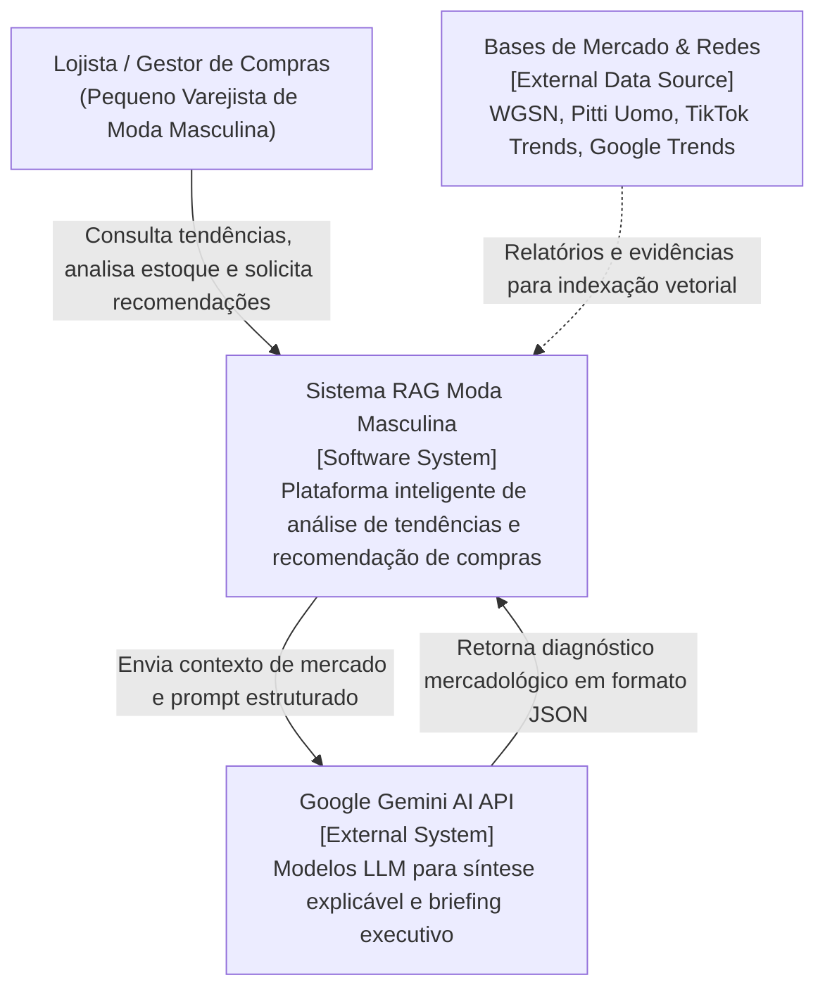
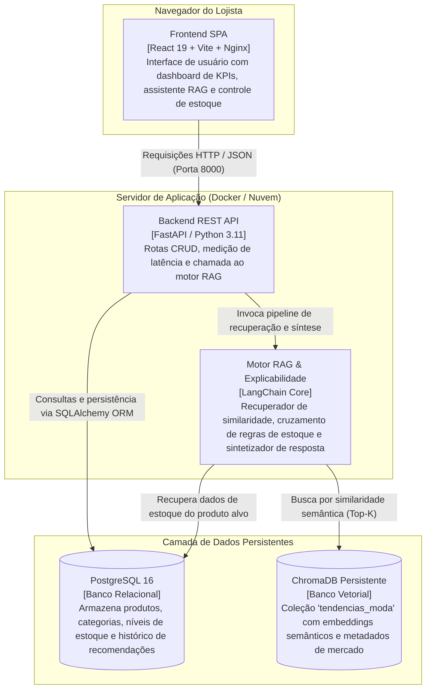
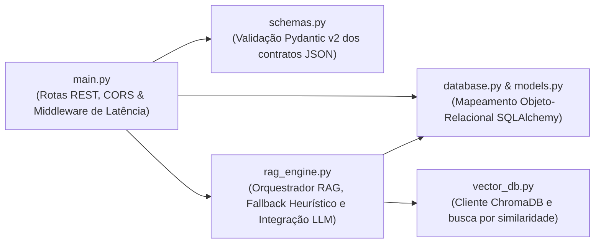
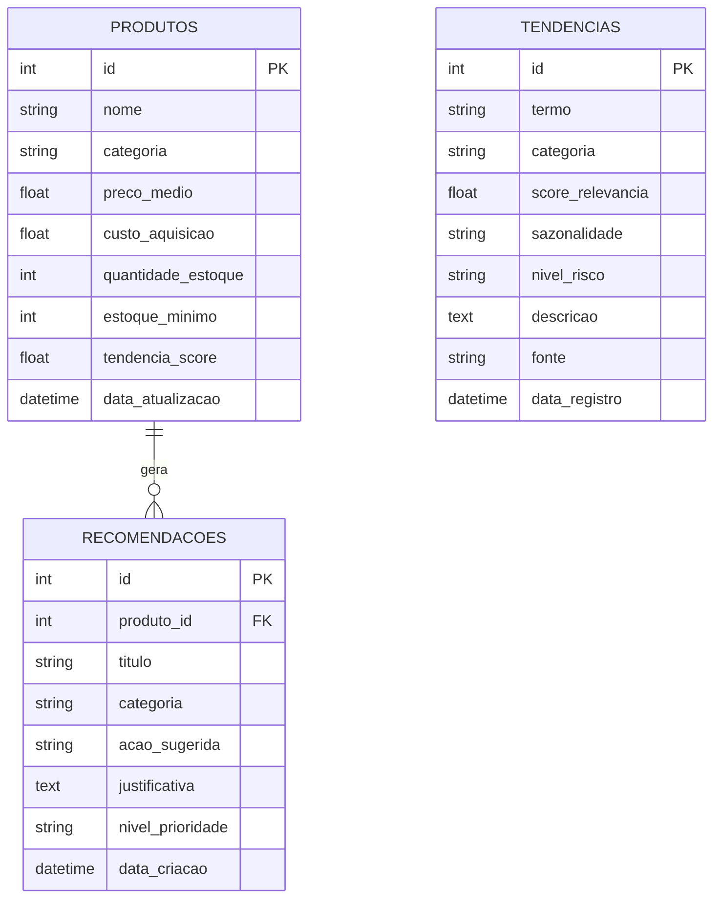
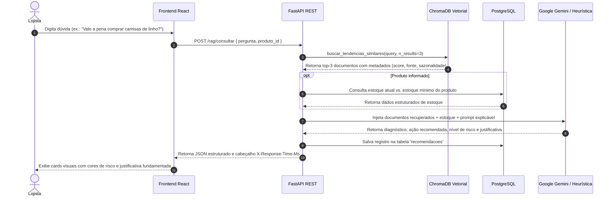

# Arquitetura do Projeto Moda

**Projeto:** Sistema RAG para Apoio à Tomada de Decisão no Varejo de Moda Masculina  
**Autora:** Anna Koerich  
**Instituição:** Centro Universitário Católica de Santa Catarina (Católica SC)  
**Linha de Projeto:** Inteligência Artificial (IA)  
**Semestre:** 2026/2 — 8º Período  

---

## 1. Visão Geral do Sistema

Pequenas lojas de moda masculina costumam comprar "no feeling" e acabam com estoque parado. O Projeto Moda usa **RAG (Retrieval-Augmented Generation)**: busca as tendências de mercado mais parecidas com a pergunta do lojista, cruza com o estoque da loja e devolve uma recomendação com justificativa e fontes.

---

## 2. Modelo C4 de Arquitetura

### 2.1 Nível 1: Diagrama de Contexto
Apresenta os usuários do sistema, os limites da solução e suas integrações com o mundo externo.

---

### 2.2 Nível 2: Diagrama de Containers
Decompõe o sistema em suas unidades de execução e armazenamento independentes.

---

### 2.3 Nível 3: Diagrama de Componentes (Backend FastAPI)
Detalha a organização interna dos módulos da API.

---

## 3. Modelo de Dados Relacional (DER)

---

## 4. Pipeline de Inteligência Artificial & RAG

---

## 5. Núcleo Comum de Engenharia

Requisitos do [Portfólio Directions](https://github.com/CatolicaSC-Portfolio/The-Portfolio-Playbook/blob/main/directions/portfolio-directions-GERAL.md):

| Requisito | Como está no projeto |
| :--- | :--- |
| Wiki | Este conteúdo, publicado na Wiki do GitHub do repositório. |
| CI/CD | `.github/workflows/ci.yml`: Ruff, Pytest (com PostgreSQL), lint/build do frontend, SonarCloud, imagens no GHCR e deploy na Azure. |
| Análise estática e segurança | Ruff e Oxlint no pipeline; SonarCloud (`sonar-project.properties`). |
| Observabilidade | Prometheus coleta `/metrics` das duas APIs (requisições, latência, erros, chamadas e latência do LLM, origem das respostas do RAG); Grafana com painel e alertas. Ver [observabilidade](observabilidade.md). |
| Ambientes | Desenvolvimento local (`docker-compose.yml`), homologação (`develop`) e produção (`main`) na VM, ver [ADR 001](adr-001-hospedagem-nuvem.md). |

---

## 6. Execução

Ver [README](../README.md#rodando-localmente) para rodar localmente e o
[ADR 001](adr-001-hospedagem-nuvem.md) para o deploy.
