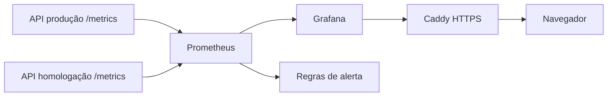

# Observabilidade

## Visão geral



- **Métricas:** cada API expõe `/metrics` no formato Prometheus. O endpoint só é acessível pela
  rede interna do Docker (`moda_monitor`). O Nginx devolve 404 para `/api/metrics` vindo de fora.
- **Coleta:** o Prometheus lê as duas APIs a cada 30 s e guarda 30 dias (limite de 1 GB).
- **Visualização:** Grafana em `https://monitor.<ip>.sslip.io`, com o painel "Projeto Moda - API e
  RAG" já provisionado. Visitantes veem sem login (somente leitura); editar exige o usuário admin.
- **Logs:** `docker compose -p moda-production logs -f backend` na VM. As rotas de IA também
  registram método, rota, status e tempo de resposta.

## O que é medido

| Métrica | Origem | Para que serve |
|---|---|---|
| `http_requests_total{handler,method,status}` | prometheus-fastapi-instrumentator | volume e erros por rota |
| `http_request_duration_seconds` | prometheus-fastapi-instrumentator | latência por rota (p95 no painel) |
| `moda_llm_chamadas_total{operacao,resultado}` | `metricas.py` | quantas chamadas ao Gemini deram certo ou falharam |
| `moda_llm_latencia_segundos{operacao}` | `metricas.py` | tempo de resposta do Gemini por operação |
| `moda_rag_respostas_total{origem}` | `metricas.py` | quantas respostas vieram do LLM e quantas das regras locais |
| `up` | Prometheus | se a API está respondendo |

`operacao` é `consulta_rag`, `analisar_produto`, `gerar_tendencias` ou `briefing`. Todas as chamadas
ao LLM passam por `rag_engine._invocar_llm`, que mede tempo e resultado.

A métrica de origem das respostas é a mais importante para o domínio: o RAG nunca fica sem resposta,
porque cai para as regras locais quando o Gemini falha. Sem essa métrica, uma falha do LLM passaria
despercebida, já que a API continuaria respondendo 200.

## Alertas (`infra/monitoramento/alertas.yml`)

| Alerta | Condição |
|---|---|
| ApiForaDoAr | API sem responder ao Prometheus por 2 min |
| TaxaDeErrosAlta | mais de 5% de respostas 5xx por 5 min |
| LLMFalhando | mais da metade das chamadas ao LLM falhando em 15 min |
| LLMLento | p95 do LLM acima de 20 s por 10 min |

Os alertas aparecem no Grafana (Alerting) e no Prometheus. Não há envio por e-mail: para o volume do
projeto, acompanhar o painel é suficiente.

## Subir na VM (uma vez)

```bash
docker network create moda_monitor
cd /opt/projeto-moda/repo/infra/monitoramento
docker compose --env-file /opt/projeto-moda/.env.monitoramento up -d
```
